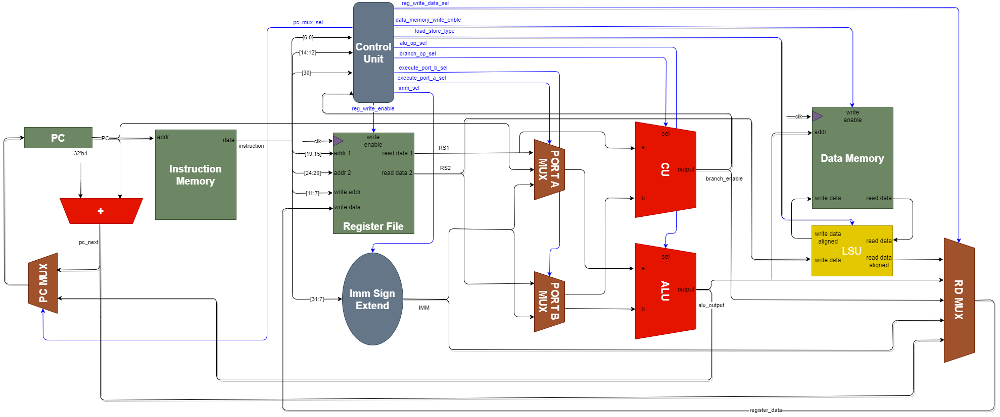

# RV32I com instruções customizadas para IA



Projeto da Unidade 2 de DIM0129 (DIMAp/UFRN, 2026.2). Partimos do processador RV32I monociclo de [Hariesh Anbalagan](https://github.com/HarieshAnbalagan/RV32I), escrito em SystemVerilog, e adicionamos as três instruções pedidas no enunciado (`max`, `mac` e `sign`) e também uma `mul`.

O enunciado está em [docs/DIM0129_-_RISC-V_III.pdf](docs/DIM0129_-_RISC-V_III.pdf).

## Autores
Este projeto foi desenvolvido por Carlos Alberto de Lima Neto (<carlos.neto.087@ufrn.edu.br>), Leandro Andrade de Araujo (<leandro.andrade.401@ufrn.edu.br>), Luiz Guilherme Carvalho Viana(<luiz.viana.097@ufrn.edu.br>) e Osvaldo Heitor de Andrade Tavares de Souza(< heitor.andrade.102@ufrn.edu.br>).

## Instruções adicionadas

| Instrução | Semântica | Relação com IA |
|---|---|---|
| `mul rd, rs1, rs2` | `rd = rs1 * rs2` (32 bits baixos) | Base para a `mac` |
| `max rd, rs1, rs2` | `rd = max(rs1, rs2)`, com sinal | Pooling / redução |
| `mac rd, rs1, rs2` | `rd = rd + rs1 * rs2` | Redes neurais, convolução |
| `sign rd, rs1` | `rd = -1` se `rs1 < 0`, `0` se `rs1 = 0`, `1` se `rs1 > 0` | Ativação, classificação, quantização |

### Codificação

As quatro instruções aritméticas da tabela acima usam o formato R (opcode `0110011`) com `funct7 = 0100000`. A `CoreControlUnit` decodifica as instruções R pelo par `{funct7[5], funct3}`:

| Instrução | funct3 | `{funct7[5], funct3}` | Exemplo |
|---|---|---|---|
| `mul` | `010` | `4'b1010` | `0x4020A1B3` = `mul x3, x1, x2` |
| `max` | `001` | `4'b1001` | `0x402091B3` = `max x3, x1, x2` |
| `mac` | `011` | `4'b1011` | `0x4020B1B3` = `mac x3, x1, x2` |
| `sign` | `100` | `4'b1100` | `0x4000C233` = `sign x4, x1` (`rs2 = x0`) |

Os códigos que ainda estão livres ficam anotados em [code_free.md](code_free.md).

Essas codificações são próprias deste projeto. A `mul` não segue a `mul` da extensão M (`funct7 = 0000001`, `funct3 = 000`), e a `sign` tem a mesma codificação do `xnor` da extensão Zbb. Por isso o GCC não gera essas instruções e o `objdump` não as reconhece.

### Interface do acelerador neural

O módulo combinacional `NeuralAccelerator.sv` calcula `max(0, x1*w1 + x2*w2)` com entradas signed de 8 bits e saída signed de 32 bits. Como cada instrução pode ler apenas dois registradores fonte, o núcleo usa duas instruções customizadas para carregar os quatro operandos e uma para obter o resultado:

| Instrução | Codificação | Ação |
|---|---|---|
| `acc_load rs1, rs2` | opcode custom-0 `0001011`, `funct3=000` | Guarda os oito bits baixos dos dois registradores como um par signed. Cargas sucessivas alternam entre `(x1,w1)` e `(x2,w2)`, começando pelo primeiro par após reset. |
| `acc_exec rd` | opcode custom-0 `0001011`, `funct3=001` | Calcula a soma ponderada, aplica ReLU e grava o resultado em `rd`. |

Exemplo: `acc_load x1,x2`, `acc_load x3,x4`, `acc_exec x5` calcula com `(x1,x2)` como primeiro par e `(x3,x4)` como segundo par. No teste, `5*3 + 4*(-2) = 7`; o caso `-5*4 + 2*(-3) = -26` é retificado para zero.

### Mudanças no hardware

| Arquivo | Mudança |
|---|---|
| `risc_v_32_i_pkg.sv` | `OP_MUL`, `OP_MAX`, `OP_MAC` e `OP_SIGN` no enum `alu_select_e`; `RD_MUX_ACCEL` no mux de writeback |
| `CoreControlUnit.sv` | Decode das operações R e das instruções `acc_load`/`acc_exec` |
| `ArithmeticLogicUnit.sv` | As quatro operações novas e a porta `alu_port_c_i`, usada pela `mac` |
| `RegisterFile.sv` | Terceira porta de leitura (`read_address_3_i`), que lê o valor atual de `rd` para a `mac` |
| `NeuralAccelerator.sv` | Armazena os pares de operandos carregados e calcula produtos, soma e ReLU |
| `ProcessorCore.sv` | Instancia o acelerador, conecta os pares de registradores e encaminha o resultado ao writeback |

`mul`, `max` e `sign` usam o caminho de dados que toda instrução R já tem. A `mac` é a única que precisou de um operando a mais. Os detalhes estão em [docs/mac_operation.md](docs/mac_operation.md), [docs/max_operation.md](docs/max_operation.md) e [docs/sign_operation.md](docs/sign_operation.md).

## Estrutura

- `src/single_cycle_processor/`: RTL do processador e do acelerador neural
- `tb/top.sv`: testbench que confere os resultados sozinho
- `*_test.txt`, `L_S_type.txt`: programas de teste em hexadecimal
- `neural_test.txt`: teste integrado de `acc_load`/`acc_exec` e ReLU
- `expected/`: resultados esperados de cada teste
- `Data_Memory_Load.txt`: conteúdo inicial da memória de dados
- `docs/`: enunciado, documentação das instruções e imagens

## Simulação

No ModelSim:

1. Adicione ao projeto todos os arquivos `.sv` de `src/single_cycle_processor/` e o `tb/top.sv`.
2. Compile tudo (Compile All).
3. Simule:

```text
vsim work.top
add wave -r /*
run -all
```

Para escolher outro teste, selecione o programa e o arquivo de resultados esperados:

- `+IMEM=<arquivo>` escolhe o programa lido por `$readmemh` (por exemplo, `+IMEM=neural_test.txt`);
- `+TEST=<nome>` escolhe `expected/<nome>_expected.txt`; esse nome não troca o programa.

Exemplo para rodar o acelerador neural no modo de linha de comando:

```text
vsim -c work.top +TEST=neural_test +IMEM=neural_test.txt -do "run -all; quit -f"
```

O projeto também roda no Icarus Verilog 12 (`iverilog -g2012`), desde que a linha do SRA/SRL em `CoreControlUnit.sv` receba um cast para `alu_select_e`. O Icarus recusa a linha sem o cast; o ModelSim aceita.

## Testes

O testbench lê `expected/<teste>_expected.txt` e executa o programa até o store de conclusão (a linha `COMPLETE` do arquivo). Depois compara os registradores e a memória com o esperado e imprime `PASS` ou uma linha `MISMATCH` para cada diferença.

| Teste | O que verifica | Ciclos |
|---|---|---|
| `L_S_type` | Loads e stores do RV32I: byte, meia palavra e palavra, com e sem sinal | 18 |
| `mul_test` | `6 * 7 = 42` | 4 |
| `max_test` | `max(-5, 9) = 9`, comparação com sinal | 4 |
| `mac_test` | `3 + 5 * 7 = 38` | 5 |
| `mac_test2` | Soma `x1 + x2`, acumula o produto com MAC (`12 + 5 * 7 = 47`) e subtrai `x2` (`x4 = 40`) | 6 |
| `mac_test3` | Soma, MAC em `x4` (`12 + 5 * 7 = 47`), subtração (`47 - 2 = 45`) e novo MAC (`45 + 7 * 2 = 59`); grava `59` na memória | 8 |
| `neural_test` | Acelerador integrado: `5*3 + 4*(-2) = 7` e `-5*4 + 2*(-3) = -26`, retificado para `0`; grava ambos os resultados | 16 |
| `neural_alu_test` | 4 vetores neurais (positivo, negativo, zero e positivo), com ADD, SUB, MUL e soma com zero intercalados; grava os resultados na memória | 48 |
| `sign_test` | Negativo, zero, positivo, `0x80000000`, `0x7FFFFFFF`, `0x40000000`, `rs1 = x0` e `rd = rs1` | 17 |
| `R_type` | Instruções R do RV32I base (`add`, `sub`, `sll`, `slt`, `sltu`, `xor`, `srl`, `sra`, `or`, `and`), programa enviado pela professora | 12 |

O `R_type` não termina com um store, então precisa rodar no modo de contagem de instruções. No modo padrão, o testbench espera um store que nunca acontece e termina com `timeout`:

```text
vsim work.top +TEST=R_type +TERMINATION=instruction_count +INSTRUCTION_COUNT=12
```

Nesse modo o testbench imprime uma linha `RETIRE` por instrução e, no fim, compara os registradores com `expected/R_type_expected.txt`.

## Limitações

- O processador é só monociclo. Não há versão multiciclo nem com pipeline.
- A `DataMemory` usa o endereço direto como índice de palavra (64 palavras). Por isso os testes fazem stores em `1(x0)`, `2(x0)` etc.
- Load e store de byte e de meia palavra usam sempre a parte baixa da palavra. O store grava a palavra inteira, completada com zeros, porque a `DataMemory` não usa o strobe.

## Licença e créditos

GNU GPL v3, ver [LICENSE](LICENSE). Processador base de [Hariesh Anbalagan](https://github.com/HarieshAnbalagan/RV32I). Enunciado da Profa. Monica Pereira.
