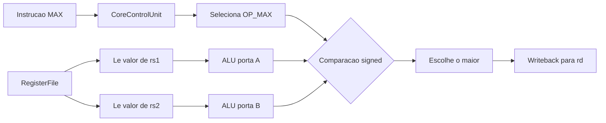

# MAX Operation — Componentes e teste

## Visão geral

A operação customizada `OP_MAX` escolhe o maior entre dois operandos interpretados como inteiros signed de 32 bits:

```text
rd = max(rs1, rs2)
```

A comparação é com sinal, em complemento de 2. Por exemplo, `0xFFFFFFFB` representa `-5`, então `max(-5, 9)` resulta em `9`.

Relação com IA: uma operação MAX pode ser usada em pooling e em reduções que selecionam o maior valor.

## Codificação

A instrução usa o formato R com opcode `0110011`, `funct7 = 0100000` e `funct3 = 001`. A unidade de controle deste projeto examina `{funct7[5], funct3}` — correspondente ao bit 30 e ao campo `funct3` — e reconhece o padrão `4'b1001` como `OP_MAX`.

| Campo | Valor |
|---|---|
| `funct7` | `0100000` |
| `rs2` | registrador fonte 2 |
| `rs1` | registrador fonte 1 |
| `funct3` | `001` |
| `rd` | registrador destino |
| `opcode` | `0110011` |

Exemplo de codificação:

```text
0x402091B3 = max x3, x1, x2
```

A codificação é específica deste núcleo; ferramentas que não conhecem a extensão customizada podem não reconhecer a instrução como `max`.

## Componentes envolvidos

### `risc_v_32_i_pkg.sv`

O enum `alu_select_e` contém `OP_MAX`, que identifica a operação selecionada para a ALU.

### `CoreControlUnit.sv`

No decode das instruções R, o padrão `4'b1001` seleciona `OP_MAX`, seleciona `rs1` e `rs2` como operandos da ALU e encaminha o resultado da ALU para o writeback de `rd`.

### `ArithmeticLogicUnit.sv`

A operação é implementada por uma comparação signed:

```systemverilog
OP_MAX: alu_o = ($signed(alu_port_a_i) > $signed(alu_port_b_i))
             ? alu_port_a_i
             : alu_port_b_i;
```

Se os operandos forem iguais, a expressão retorna `alu_port_b_i`; como os valores são iguais, o resultado numérico é o mesmo.

### `ProcessorCore.sv` e `RegisterFile.sv`

Como `MAX` é uma instrução R normal, o caminho já existente lê `rs1` e `rs2`, envia-os às portas A e B da ALU e grava `alu_o` em `rd`. Diferentemente da MAC, `MAX` não precisa ler o valor antigo do destino e não exige uma terceira porta de leitura no banco de registradores.

## Datapath



Equivalente em expressão:

```text
alu_o = ($signed(rs1) > $signed(rs2)) ? rs1 : rs2
rd = alu_o
```

## Teste

Arquivos usados:

- Programa: `max_test.txt`
- Estado esperado: `expected/max_test_expected.txt`

O programa contém quatro instruções:

| Palavra | Operação | Resultado |
|---|---|---|
| `FFB00093` | `addi x1,x0,-5` | `x1=0xFFFFFFFB` |
| `00900113` | `addi x2,x0,9` | `x2=9` |
| `402091B3` | `max x3,x1,x2` | `x3=9` |
| `00302023` | `sw x3,0(x0)` | `MEM[0]=9` |

O arquivo esperado contém, entre outros valores:

```text
REGISTER 1 fffffffb
REGISTER 2 00000009
REGISTER 3 00000009
MEMORY 0 00000009
COMPLETE 0 00000009
```

O resultado documentado para o teste é a conclusão após 4 ciclos e `max_test TEST: PASS`.

## Decisões e limites do teste

- **Comparação signed:** `$signed` é necessário para que `0xFFFFFFFB` seja interpretado como `-5`, e não como um número unsigned grande.
- **Operação na ALU:** MAX usa o caminho de dados R-type e retorna um dos próprios operandos; não há instrução intermediária nem terceiro operando.
- **Teste focado:** `max_test` verifica o caso misto `max(-5,9)=9`. Ele valida a comparação com sinal nesse exemplo, mas não cobre todos os casos de borda, como dois negativos, operandos iguais ou o maior operando vindo de `rs1`.
- **Store de conclusão:** o `sw` final permite ao testbench detectar o fim do programa comparando endereço e dado com a linha `COMPLETE` do arquivo esperado.
- **Memória simplificada:** a memória de dados do projeto usa o endereço diretamente como índice de palavra; por isso o programa armazena em `0(x0)`.
