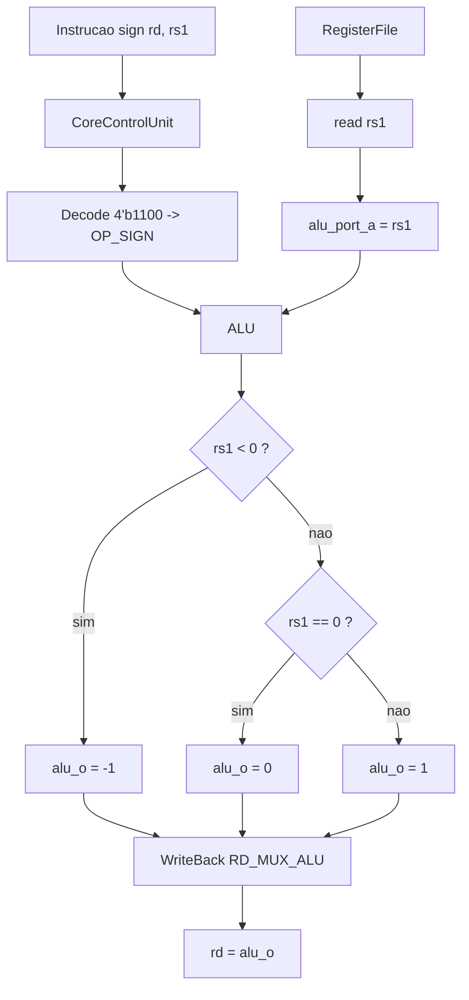

# SIGN Operation — Componentes alterados

## Visão geral
A operação `OP_SIGN` foi implementada como uma instrução customizada do tipo:

`rd = SIGN(rs1)`

```text
            ⎧ -1  se rs1 < 0
SIGN(rs1) = ⎨  0  se rs1 = 0
            ⎩  1  se rs1 > 0
```

`rs1` é interpretado com sinal (complemento de 2). O resultado `-1` é gravado como `0xFFFFFFFF`.

Relação com IA: funções de ativação, classificação e quantização.

---

## Codificação

Formato R-type, com o campo `rs2` fixo em `x0` (não usado):

| funct7 | rs2 | rs1 | funct3 | rd | opcode |
|---|---|---|---|---|---|
| `0100000` | `00000` | rs1 | `100` | rd | `0110011` |

A `CoreControlUnit` decodifica as instruções R-type por `{funct7[5], funct3}`. A SIGN usa o código `4'b1100`, que estava livre em `code_free.md`. Essa combinação não existe no RV32I base, mas coincide com o `xnor` da extensão Zbb (ver [Decisões de projeto](#decisões-de-projeto)).

Exemplo: `sign x4, x1` = `0x4000C233`.

---

## Componentes alterados

### 1) risc_v_32_i_pkg.sv
Novo valor `OP_SIGN` no enum `alu_select_e`, entre `OP_MAC` e `OP_UNKNOWN`. O enum passa a ter 13 valores e continua cabendo em `ALU_SEL_LEN = 4`.

### 2) CoreControlUnit.sv
Novo caso no decode R-type:

```systemverilog
4'b1100:
    begin
    alu_op_sel_o = OP_SIGN;
    comp_op_sel_o = OP_BUNKNOWN;
    execute_port_b_sel_o = 1'b1;
    reg_write_data_sel_o = RD_MUX_ALU;
    end
```

### 3) ArithmeticLogicUnit.sv

```systemverilog
OP_SIGN:    alu_o = ($signed(alu_port_a_i) < 0) ? {XLEN{1'b1}}               // x < 0 -> -1
                  : (alu_port_a_i == 0)         ? {XLEN{1'b0}}               // x = 0 ->  0
                  :                               {{(XLEN-1){1'b0}}, 1'b1};  // x > 0 ->  1
```

### O que não mudou
Ao contrário da MAC, a SIGN não precisou de porta extra no `RegisterFile` nem de sinal novo no `ProcessorCore`. Em toda instrução R-type, `rs1` já chega na porta A da ULA (`execute_port_a_sel = 1`) e a saída da ULA já volta para `rd` (`RD_MUX_ALU`). A porta B (rs2 = x0) é ignorada pela operação.

---

## Desenho dos blocos



Custo em hardware: `rs1 < 0` é o bit 31 de `rs1`; `rs1 == 0` é uma NOR de 32 entradas; a saída é um mux de três constantes.

---

## Teste

Arquivos: `sign_test.txt` e `expected/sign_test_expected.txt`.

| Caso | Entrada (rs1) | Esperado (rd) |
|---|---|---|
| negativo | `fffffffb` (-5) | `ffffffff` |
| zero | `00000000` | `00000000` |
| positivo | `00000009` | `00000001` |
| mais negativo | `80000000` | `ffffffff` |
| maior positivo | `7fffffff` | `00000001` |
| positivo par, só bits altos | `40000000` | `00000001` |
| rs1 = x0 | `x0` | `00000000` |
| rd = rs1 | `sign x1, x1` com x1 = -5 | `ffffffff` |

Resultado esperado no transcript:

```
# sign_test TEST: completion detected after 17 cycles
# sign_test TEST: PASS
```

---

## Decisões de projeto

Esta seção registra as escolhas feitas na implementação e o motivo de cada uma.

### 1. Opcode `0110011` (tipo R)
É o mesmo opcode usado por MUL, MAX e MAC neste projeto. Assim a SIGN aproveita o caminho que toda instrução tipo R já tem (ler `rs1`, escrever em `rd`) e não precisa de um opcode novo no decodificador.

### 2. Código `{funct7[5], funct3} = 4'b1100`
A `CoreControlUnit` só olha o bit 5 do `funct7` (bit 30 da instrução) junto com o `funct3`. O `4'b1100` era o primeiro código livre em `code_free.md`; depois dele restam `4'b1110` e `4'b1111`. Com os campos completos, isso dá `funct7 = 0100000` e `funct3 = 100`.

No RV32I base, `funct7 = 0100000` só aparece com `funct3 = 000` (SUB) e `funct3 = 101` (SRA). Então o código não conflita com nenhuma instrução do conjunto base.

### 3. Coincidência com a extensão Zbb
A codificação `0100000 | rs2 | rs1 | 100 | rd | 0110011` é a mesma da instrução `xnor rd, rs1, rs2` da extensão Zbb (manipulação de bits). Isso tem duas consequências:
- um disassembler que conhece Zbb (por exemplo, o `objdump` do GNU) mostra `0x4000C233` como `xnor x4, x1, zero`, e não como `sign`;
- se o núcleo um dia implementar Zbb, a SIGN vai precisar de outro código.

Este núcleo não implementa Zbb, então não há conflito hoje. Os dois códigos livres restantes têm o mesmo problema: `4'b1110` coincide com `orn` e `4'b1111` com `andn`, ambos da Zbb. As outras instruções do projeto também usam codificações próprias: a MUL deste núcleo, por exemplo, não segue a MUL oficial da extensão M (`funct7 = 0000001`, `funct3 = 000`).

### 4. Campo `rs2 = x0`
A SIGN tem um único operando, então o campo `rs2` é preenchido com zero. O decodificador não confere esse campo, nem os outros bits do `funct7` além do bit 5; isso já valia para todas as instruções tipo R do projeto. Na prática, se `rs2 ≠ 0`, a ULA ignora a porta B e o resultado continua sendo `SIGN(rs1)`.

Para montar a instrução com o GNU as, que não conhece `sign`:

```text
.insn r 0x33, 4, 0x20, x4, x1, x0    # sign x4, x1
```

### 5. Forma da expressão na ULA
A ULA usa `$signed(alu_port_a_i) < 0` e `alu_port_a_i == 0`, na mesma ordem da definição matemática (negativo, zero, positivo) e com `$signed`, como a MAX. Existe uma forma equivalente mais curta, `{{31{x[31]}}, |x}`: o bit de sinal repetido nos 31 bits altos e o OU de todos os bits no bit 0. O hardware gerado é o mesmo, porque a síntese reduz `x < 0` ao bit 31. A forma por extenso foi escolhida por ser mais fácil de conferir contra a definição.

### 6. Posição no enum
`OP_SIGN` foi inserido entre `OP_MAC` e `OP_UNKNOWN`, como foi feito com MAX e MAC. Isso muda o valor numérico de `OP_UNKNOWN` de 11 para 12. Nenhum arquivo usa esse valor numérico, e os 13 valores continuam cabendo em `ALU_SEL_LEN = 4`. Os testes `mul_test`, `max_test` e `mac_test` continuam passando.

### 7. Escolhas do teste
- **Casos:** além de negativo, zero e positivo, o teste usa valores que pegam erros comuns:
  - `0x80000000`, para pegar comparação sem sinal;
  - `0x7FFFFFFF`, para pegar o uso do bit errado como sinal (por exemplo, o bit 30 no lugar do 31);
  - `0x40000000` (só bits altos) e `9` (só bits baixos), para pegar uma detecção de zero que olha só parte dos bits;
  - `rs1 = x0`;
  - `rd = rs1`.
- **Endereços dos stores:** `sw x5, 1(x0)` e `sw x6, 2(x0)` usam os endereços 1 e 2 porque a `DataMemory` deste projeto usa o endereço direto como índice de palavra, como no `L_S_type`. Num RV32I real, esses stores seriam desalinhados.
- **Término:** o teste termina no store de `SIGN(9)` (endereço 2, valor 1), assim como MAX e MAC terminam no resultado da própria operação. Por isso, se o caso positivo quebrar, o testbench mostra apenas `timeout`, sem linhas `MISMATCH`.
- **Teste padrão:** `InstructionMemory.sv` e `tb/top.sv` passaram a carregar o `sign_test`, como foi feito em cada instrução anterior. Para rodar outro teste, troque o nome nesses dois arquivos.
- **Simulador:** o teste foi rodado no Icarus Verilog 12, numa cópia do projeto com um cast de enum na linha do SRA/SRL da `CoreControlUnit`, porque o Icarus rejeita essa linha e o ModelSim aceita. A validação oficial continua sendo no ModelSim.

### 8. Fora do escopo
A etapa 7 do roteiro (área, frequência e consumo) não foi feita, assim como nas instruções anteriores.
