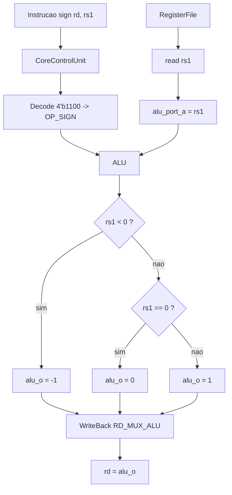

# SIGN Operation — Componentes alterados

## Visão geral
A operação `OP_SIGN` foi implementada como uma instrução customizada do tipo:

`rd = SIGN(rs1)`

```text
            ⎧ -1  se rs1 < 0
SIGN(rs1) = ⎨  0  se rs1 = 0
            ⎩  1  se rs1 > 0
```

`rs1` é interpretado com sinal (complemento de 2). O resultado `-1` é gravado como `0xFFFFFFFF`.

Relação com IA: funções de ativação, classificação e quantização.

---

## Codificação

Formato R-type, com o campo `rs2` fixo em `x0` (não usado):

| funct7 | rs2 | rs1 | funct3 | rd | opcode |
|---|---|---|---|---|---|
| `0100000` | `00000` | rs1 | `100` | rd | `0110011` |

A `CoreControlUnit` decodifica as instruções R-type por `{funct7[5], funct3}`. A SIGN usa o código `4'b1100`, que estava livre em `code_free.md`. Essa combinação não existe no RV32I base.

Exemplo: `sign x4, x1` = `0x4000C233`.

---

## Componentes alterados

### 1) risc_v_32_i_pkg.sv
Novo valor `OP_SIGN` no enum `alu_select_e`, entre `OP_MAC` e `OP_UNKNOWN`. O enum passa a ter 13 valores e continua cabendo em `ALU_SEL_LEN = 4`.

### 2) CoreControlUnit.sv
Novo caso no decode R-type:

```systemverilog
4'b1100:
    begin
    alu_op_sel_o = OP_SIGN;
    comp_op_sel_o = OP_BUNKNOWN;
    execute_port_b_sel_o = 1'b1;
    reg_write_data_sel_o = RD_MUX_ALU;
    end
```

### 3) ArithmeticLogicUnit.sv

```systemverilog
OP_SIGN:    alu_o = ($signed(alu_port_a_i) < 0) ? {XLEN{1'b1}}               // x < 0 -> -1
                  : (alu_port_a_i == 0)         ? {XLEN{1'b0}}               // x = 0 ->  0
                  :                               {{(XLEN-1){1'b0}}, 1'b1};  // x > 0 ->  1
```

### O que não mudou
Ao contrário da MAC, a SIGN não precisou de porta extra no `RegisterFile` nem de sinal novo no `ProcessorCore`. Em toda instrução R-type, `rs1` já chega na porta A da ULA (`execute_port_a_sel = 1`) e a saída da ULA já volta para `rd` (`RD_MUX_ALU`). A porta B (rs2 = x0) é ignorada pela operação.

---

## Desenho dos blocos



Custo em hardware: `rs1 < 0` é o bit 31 de `rs1`; `rs1 == 0` é uma NOR de 32 entradas; a saída é um mux de três constantes.

---

## Teste

Arquivos: `sign_test.txt` e `expected/sign_test_expected.txt`.

| Caso | Entrada (rs1) | Esperado (rd) |
|---|---|---|
| negativo | `fffffffb` (-5) | `ffffffff` |
| zero | `00000000` | `00000000` |
| positivo | `00000009` | `00000001` |
| mais negativo | `80000000` | `ffffffff` |
| maior positivo | `7fffffff` | `00000001` |
| rs1 = x0 | `x0` | `00000000` |
| rd = rs1 | `sign x1, x1` com x1 = -5 | `ffffffff` |

Resultado esperado no transcript:

```
# sign_test TEST: completion detected after 15 cycles
# sign_test TEST: PASS
```
